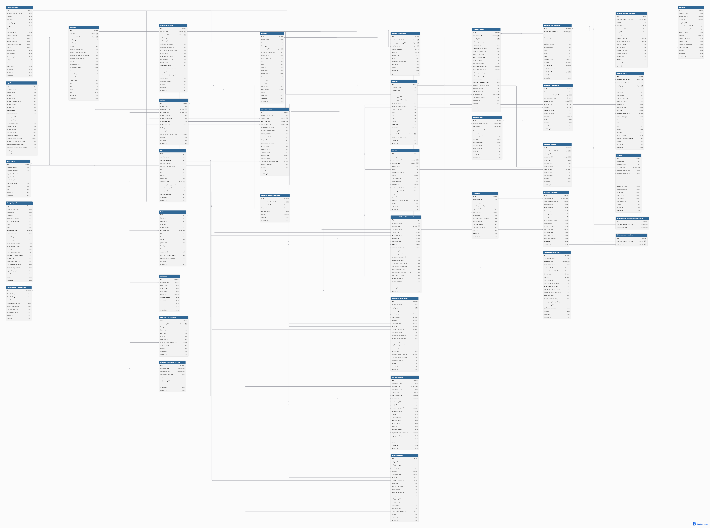

# Design Document:

LOGISTICS AND SUPPLY CHAIN MANAGEMENT INFORMATION SYSTEM

By:

OSARENKHOE IKPONMWOSA JOSEPH

Video overview: <URL HERE>

## Scope

In this section you should answer the following questions:

* What is the purpose of your database?

The purpose of the Logistics & Supply Chain Management Information System (LSCMIS) is to provide a centralized relational database for managing the core operations of a logistics and supply chain organization. The database brings together information relating to customers, employees, shipments, warehouses, inventory, procurement, suppliers,transportation operations, customer service, financial records, compliance, risk and environmental monitoring, insurance, service-level management, and operational activities.

The LSCMIS is designed to improve operational efficiency, shipment visibility, inventory accuracy, financial record management, supplier and service performance monitoring, and evidence-based decision-making. It also maintains reliable historical records of important business activities while reducing data redundancy and improving data consistency and integrity.

* Which people, places, things, etc. are you including in the scope of your database?

The database includes the people, locations, business activities, and resources that are directly involved in the operations of a logistics and supply chain organization. These include:

1.  Customers – Individuals and organizations that use the company's logistics services.
2.  Employees – Staff members involved in different departments and operational activities.
3.  Departments – Organizational units responsible for different business functions.
4.  Warehouses and hubs – Facilities used for storing, handling, and managing goods.
5.  Shipments – Logistics transactions involving the movement of goods from origin to destination.
6.  Shipment packages/inventory – Goods and items associated with shipments.
7.  Company inventory – Goods and materials held within the organization's warehouses.
8.  Products and containers – Items and storage units used in logistics operations.
9.  Suppliers – Businesses that provide goods and services to the organization.
10. Procurement activities – Purchase requests, purchase orders, and supplier-related transactions.
11. Transport assets/fleet – Trucks, motorcycles, trailers, and other transportation assets used in logistics operations.
12. Vehicles and maintenance records – Information used to manage fleet availability and maintenance.
13. Invoices and payment transactions – Financial records associated with customers and business operations.
14. Budgets and expenses – Financial planning and expenditure records.
15. Customer service activities – Customer complaints, requests, and service interactions.
16. Compliance, risk, and environmental records – Information used to monitor operational compliance, risks, and environmental factors.
17. Insurance and service-level information – Records relating to asset coverage and service commitments.
18. Historical and audit records – Records that provide accountability and preserve important operational activities.

* Which people, places, things, etc. are *outside* the scope of your database?

The following are a list of business processes that are outside the scope of the current LSCMIS database:

1. Pay roll management
2. Government customs brokerage.
3. Trade union brokerage.
4. GPS-based navigation and systems.
5. Route optimization.
6. Predictive analytics and forecasting
7. Automated payment processing and integration with external payment gateways.
8. Integration with external enterprise systems.
9. Automated quotation management.

## Functional Requirements

In this section you should answer the following questions:

* What should a user be able to do with your database?

The activities a user should be able to use the LSCMIS database to do includes and not limited to the following:
1.  Manage customer information — Create, update, retrieve, and maintain customer records and their relevant details.
2.  Manage employee and department information — Maintain employee records, departmental information, and employee–department relationships.
3.  Manage shipment information — Record and retrieve shipment details, shipment status, origin and destination information, and related shipment activities.
4.  Track shipment packages and inventory — Record packages associated with shipments and maintain information about the goods being transported as may be relevant to all stakeholders.
5.  Manage warehouse and hub operations — Manage warehouse information, monitor storage capacity and utilization, and manage warehouse-related activities.
6.  Manage company inventory and containers — Manage records of inventory items and containers used in logistics operations.
7.  Manage suppliers and procurement activities — Maintain supplier information and record procurement-related transactions, including purchase requests and purchase orders.
8.  Manage fleet and transport assets — Maintain records of vehicles and other transport assets, including their status, capacity, maintenance, insurance, and registration information.
9.  Manage customer service activities — Record and retrieve customer service requests, complaints, and related service activities.
10. Manage invoices and payment transaction records — Record, retrieve, and analyze financial transactions associated with logistics services.
11. Manage budgets and expenses — Record budgets and business expenses and compare financial information for reporting and analysis.
12. Monitor compliance, risk, and environmental information — Maintain relevant compliance, risk, environmental, insurance, and operational records.
13. Maintain historical and audit records — Preserve records of significant operational activities for accountability, auditing, and historical analysis.
14. Generate reports and perform evidence-based analysis — Use queries, views, aggregations, and other SQL features to analyze operational data and support business decision-making.
15. Retrieve information across related business areas — Use relationships between tables to obtain meaningful information about customers, shipments, inventory, warehouses, suppliers, employees, fleet, finances, and other operational activities.
16. Enforce data integrity through database constraints — Ensures that data entered into the database satisfies defined rules, relationships, required fields, uniqueness requirements, and valid references between related tables
17. Automatically enforce business rules through triggers — Allow the database to automatically perform defined actions when specific data changes occur, helping maintain consistency, accuracy, and integrity across related records
18. Indexes to improve data retrieval performance — Efficiently search and retrieve frequently accessed information from the database.

These requirements reflect the database's purpose of supporting operational management, reporting, and evidence-based business analysis.

* What's beyond the scope of what a user should be able to do with your database?

A user should not be able to use the current LSCMIS database to perform functions that are outside the scope of the project, including:

1. Payroll management.
2. Government customs brokerage.
3. Trade union brokerage.
4. GPS-based navigation and systems.
5. Route optimization.
6. Predictive analytics and forecasting.
7. Automated payment processing and integration with external payment gateways.
8. Integration with external enterprise systems.
9. Automated quotation management.

These operational processes are outside the current implementation of the LSCMIS database and are considered potential future enhancements.

## Representation

### Entities

In this section you should answer the following questions:

* Which entities will you choose to represent in your database?
The entities in my database includes:

Entities

1.  Customers
2.  Employees
3.  Suppliers
4.  Shipment_Requests
5.  Shipment_Request_Items
6.  Branches
7.  Warehouses
8.  Hubs
9. Shipment_Request_Inventory
10. Company_Inventory
11. Departments
12. Tracking_Events
13. Transport_Assets
14. Purchase_Orders
15. Purchase_Order_Items
16. Goods_Received
17. Inventory_Transactions
18. Shipment_Returns
19. Customer_Feedbacks
20. Payments
21. Supplier_Evaluations
22. Budgets
23. Expenses
24. Environmental_Impact_Assessments
25. Compliance_Assessments
26. Risk_Assessments
27. Insurance_Policies
28. Service_Level_Assessments
29. Invoices
30. Audit_Logs
31. Containers
32. Employee_Leave_History
33. Employee_Department_History
34. Shipment_Item_Classifications
35. Shipment_Item_Classification_Assignment
36. Shipment_Item_Containers
37. Company_Inventory_Locations

* What attributes will those entities have?
Each entities have the following attributes:

1. Customers

Description

Represents individuals and organizations that purchase logistics and supply chain services. Customer records support customer relationship management, shipment processing, billing, customer retention, and strategic business planning.

Schema

id — The unique identifier assigned to each customer.

customer_name — The registered name of the customer or business organization.

customer_code — This is the human-readable business reference used on documents, Excel reports, customer communication, invoices, tracking, etc.

customer_type — Specifies whether the customer is an individual or a business.

customer_special_date — A significant date associated with the customer, such as a birthday, anniversary, or important business date.

customer_special_date_type — Specifies the type or purpose of the customer's special date.

customer_email — The customer's official email address.

customer_phone_number — The customer's primary contact telephone number.

customer_address — The customer's registered residential or business address.

gender — Specifies the customer's gender, where applicable.

city — The city in which the customer is registered or located.

state — The state or province in which the customer is registered or located.

country — The country in which the customer is registered or located.

postal_code — The postal or ZIP code associated with the customer's registered address.

credit_limit — The maximum amount of credit the company has approved for the customer.

customer_status — Indicates the current status of the customer account, such as active, inactive, suspended, or blocked.

branch_id — Identifies the branch responsible for managing the customer's account.

preferred_contact_method — Specifies the customer's preferred method of communication, such as email, phone, or SMS.

created_at — The date and time when the customer record was created.

updated_at — The date and time when the customer record was last updated.

2. Employees

Description

Represents employees who work within the logistics and supply chain organization. Employee records support workforce management, branch operations, employee assignments, payroll-related information, and organizational planning.

Schema

id — The unique identifier assigned to each employee.

branch_id — Identifies the branch to which the employee is assigned.

department_id — This references the department the employee works from.

employee_name — The full name of the employee.

employee_code — This is the human-readable business reference used on documents, Excel reports, customer communication, invoices, tracking, etc.

gender — Specifies the employee's gender.

employee_special_date — A significant date associated with the employee, such as a birthday or anniversary.

employee_special_date_type — Specifies the type or purpose of the employee's special date.

employee_mobile_phone_number — The employee's primary mobile telephone number.

employee_home_address — The employee's residential address.

job_title — The employee's official position or role within the organization.

employment_type — Specifies the nature of the employee's employment, such as full-time, part-time, contract, or temporary.

employment_status — Indicates the current employment status, such as active, inactive, suspended, or terminated.

hire_date — The date on which the employee officially joined the organization.

termination_date — The date the employee's employment ended, where applicable.

email_address — The employee's official work or organizational email address.

postal_code — The postal or ZIP code associated with the employee's home address.

city — The city in which the employee resides.

state — The state or province in which the employee resides.

country — The country in which the employee resides.

salary — The employee's agreed compensation or salary amount.

created_at — The date and time when the employee record was created.

updated_at — The date and time when the employee record was last updated.

3. Suppliers

Description

Represents companies and organizations that provide goods, materials, products, or services to the logistics and supply chain organization. Supplier records support procurement, supplier performance monitoring, compliance, risk management, and purchasing decisions.

Schema

id — The unique identifier assigned to each supplier.

company_name — The registered name of the supplier company or organization.

supplier_code — This is human-readable business reference used on documents, Excel reports, customer communication, invoices, tracking, etc.

supplier_type — Specifies the type or category of supplier, such as manufacturer, distributor, wholesaler, or service provider.

supplier_email — The supplier's official business email address.

supplier_phone_number — The supplier's primary business contact telephone number.

supplier_address — The supplier's registered business address.

supplier_city — The city in which the supplier is registered or located.

supplier_state — The state or province in which the supplier is registered or located.

supplier_country — The country in which the supplier is registered or located.

supplier_postal_code — The postal or ZIP code associated with the supplier's registered address.

supplier_rating — The performance rating assigned to the supplier based on factors such as quality, reliability, delivery, and service.

contract_start_date — The date on which the supplier contract or business relationship officially begins.

payment_terms — The agreed conditions and timeframe for making payments to the supplier.

supplier_status — Indicates the current status of the supplier, such as active, inactive, suspended, or terminated.

lead_time_days — The expected number of days between placing an order with the supplier and receiving the goods or services.

quality_certification — Identifies quality certifications held by the supplier that demonstrate compliance with applicable quality standards.

minimum_order_quantity — The minimum quantity of goods that must be ordered from the supplier per purchase order.

supplier_risk_level_assessment — Indicates the assessed level of risk associated with the supplier, such as low, medium, or high.

supplier_registration_number — The official registration number assigned to the supplier's business by the relevant authority.

supplier_tax_identification_number — The official tax identification number associated with the supplier.

created_at — The date and time when the supplier record was created.

updated_at — The date and time when the supplier record was updated.

4. Shipment_Requests

Description

Represents shipment requests submitted by customers and manages the shipment transaction from request and collection through transportation and delivery.

Schema

id — The unique identifier assigned to each shipment request and shipment transaction.

customer_id — References the customer requesting the logistics service.

branch_id — References the branch responsible for processing the shipment request.

shipment_request_code — The unique business reference code assigned to the shipment request.

request_date — The date the shipment request was submitted.

requested_pickup_date — The date requested by the customer for shipment collection.

requested_delivery_date — The date requested by the customer for delivery.

actual_pickup_date — The actual date the shipment was collected or received by the company.

actual_delivery_date — The actual date the shipment was delivered to the recipient or designated destination.

pickup_address — The address from which the shipment is to be collected when company pickup is requested.

destination_address — The designated delivery address provided for the shipment.

destination_branch_id — References the destination branch when the shipment is delivered to a company branch.

destination_hub_id — References the destination hub when the shipment is delivered to a company hub.

shipment_receiving_mode — Indicates how the company receives the shipment, such as Customer Drop-off, Branch Drop-off, Hub Drop-off, or Company Pickup.

shipment_service_level — Specifies the service priority, such as Standard, Express, Priority, or Same-Day.

shipment_type — Classifies the shipment according to its service or operational category.

secondary_packaging_type — The outer packaging used to consolidate one or more shipment items into the final shipment package.

secondary_packaging_material — The material used for the outer/secondary packaging.

shipment_status — Indicates the current lifecycle status of the shipment request.

special_instructions — Customer instructions concerning handling, collection, transportation, or delivery.

employee_id — References the employee responsible for processing the shipment request.

cancellation_reason — Specifies the reason the shipment request was cancelled, where applicable.

cancelled_at — The date and time the shipment request was cancelled, where applicable.

remarks — Additional operational remarks concerning the shipment request.

created_at — The date and time the shipment request record was created.

updated_at — The date and time the shipment request record was last modified.

5. Shipment_Request_Items

Description

Represents the individual packages or shipment items associated with a shipment request. It records the item-level details required for shipment processing, measurement, pricing, handling, and verification. A single shipment request may contain multiple shipment request items.

Schema

id — The unique identifier assigned to each shipment request item.

shipment_request_id — References the shipment request to which the item belongs and establishes the relationship between the shipment transaction and its individual items.

item_description — Describes the contents or general nature of the shipment item as declared by the customer.

item_category — Identifies the business category of the shipment item, such as clothing, electronics, documents, food, or other applicable categories.

quantity — Records the number of units represented by the shipment request item.

declared_weight — Records the weight declared by the customer before the item is physically verified.

verified_weight — Records the weight measured by the logistics company during physical verification.

length — Records the measured length of the shipment item for dimensional-weight and handling calculations.

width — Records the measured width of the shipment item.

height — Records the measured height of the shipment item.

declared_value — Records the monetary value declared by the customer for the shipment item for valuation, insurance, and compliance purposes.

is_fragile — Indicates whether the shipment item requires fragile-item handling.

is_hazardous — Indicates whether the customer has declared the item as containing hazardous materials requiring special handling or compliance review.

verification_status — Records the outcome of the physical verification process, such as pending, verified, discrepancy, or rejected.

verified_by — References the employee responsible for physically verifying the shipment item.

verified_at — Records the date and time at which the shipment item was physically verified.

created_at — Records the date and time when the shipment request item was created.

6. Branches

Description

Represents the physical branches operated by the logistics organization. Branch records manage branch identification, location, contact information, operating schedules, assigned personnel, warehouse relationships, and operational status.

Schema

id — The unique identifier assigned to each branch.

branch_code — The unique business reference code assigned to the branch.

branch_name — The official name assigned to the branch.

branch_type — Specifies the operational type of the branch, such as headquarters, regional branch, local branch, or distribution branch.

employee_id — References the employee responsible for managing or overseeing the branch.

branch_phone_number — The primary telephone number for the branch.

carbon_level — This records the carbon emission level associated with the branch.

branch_address — The registered physical address of the branch.

city — The city in which the branch is located.

state — The state or province in which the branch is located.

country — The country in which the branch is located.

postal_code — The postal or ZIP code associated with the branch address.

branch_status — Indicates the current operational status of the branch, such as active, inactive, temporarily closed, or permanently closed.

branch_email — The official email address used for communication with the branch.

operating_days — Specifies the days of the week on which the branch operates.

opening_time — The normal time at which the branch begins daily operations.

closing_time — The normal time at which the branch ends daily operations.

warehouse_id — References the warehouse associated with the branch, where applicable.

latitude — Records the geographical latitude of the branch location.

longitude — Records the geographical longitude of the branch location.

created_at — The date and time when the branch record was created.

updated_at — The date and time when the branch record was last updated.

7. Warehouses

Description

Represents the company's warehouse facilities used for storing, managing, and distributing inventory to branches and other operational locations. Warehouse records capture facility identification, location, responsible personnel, storage capacity, utilization, environmental impact, and operational status.

Schema

id — The unique identifier assigned to each warehouse.

warehouse_code — The unique business reference code assigned to the warehouse.

warehouse_name — The official name assigned to the warehouse.

warehouse_address — The registered physical address of the warehouse.

warehouse_phone_number — The official phone number designated to the warehouse.

city — The city in which the warehouse is located.

state — The state or province in which the warehouse is located.

country — The country in which the warehouse is located.

postal_code — The postal or ZIP code associated with the warehouse address.

employee_id — References the employee responsible for managing or overseeing the warehouse.

maximum_storage_capacity — The maximum quantity or volume of inventory that the warehouse is designed and authorized to store.

current_storage_utilization — The amount or percentage of the warehouse's storage capacity currently being utilized.

carbon_level — Records the measured or assessed carbon emissions level associated with the warehouse's operations.

warehouse_status — Indicates the current operational status of the warehouse, such as active, inactive, under maintenance, or closed.

created_at — The date and time when the warehouse record was created.

updated_at — The date and time when the warehouse record was last updated.

8. Hubs

Description

Represents operational hubs used to receive, consolidate, temporarily store, process, and transfer shipments within the logistics network. Hub records capture identification, location, management responsibility, capacity, environmental impact, and operational status.

Schema

id — The unique identifier assigned to each hub.

hub_code — The unique business reference code assigned to the hub.

hub_name — The official name assigned to the hub.

hub_address — The registered physical address of the hub.

phone_number — The official telephone number designated to the hub.

employee_id — References the employee responsible for managing or overseeing the hub.

city — The city in which the hub is located.

state — The state or province in which the hub is located.

country — The country in which the hub is located.

postal_code — The postal or ZIP code associated with the hub address.

hub_type — Specifies the operational type of the hub.

hub_status — Indicates the current operational status of the hub.

carbon_level — Records the measured or assessed carbon emissions level associated with the hub's operations.

maximum_storage_capacity — The maximum quantity or volume of inventory the hub is designed to store.

current_storage_utilization — The amount or percentage of the hub's storage capacity currently being utilized.

created_at — The date and time when the hub record was created.

updated_at — The date and time when the hub record was updated.

9. Shipment_Request_Inventory

Description

Represents inventory records associated with shipment request items while they are held within the company's logistics network.

Schema

id — The unique identifier assigned to each shipment request inventory record.

shipment_request_item_id — References the shipment request item associated with the inventory record.

barcode — Identifies the shipment item using its barcode.

branch_id — References the branch associated with the shipment inventory, where applicable.

warehouse_id — References the warehouse associated with the shipment inventory, where applicable.

hub_id — References the hub associated with the shipment inventory, where applicable.

storage_location — Identifies the physical location where the shipment item is stored.

quantity_received — Records the quantity of the shipment item received.

current_quantity_level — Records the current quantity of the shipment item held in inventory.

inventory_status — Indicates the current status of the shipment inventory.

item_condition — Records the physical condition of the shipment item.

storage_start_date — Records when storage of the shipment item began.

storage_end_date — Records when storage of the shipment item ended, where applicable.

security_level — Records the security level required for the stored shipment item.

remarks — Additional information concerning the shipment inventory.

created_at — The date and time when the shipment request inventory record was created.

updated_at — The date and time when the shipment request inventory record was last updated.

10. Company_Inventory

Description

Represents goods, materials, supplies, and other inventory owned or controlled by the company for its internal logistics and operational activities.

Schema

id — The unique identifier assigned to each company inventory item.

company_inventory_code — The unique business reference code assigned to the company inventory item.

barcode — Identifies the inventory item using its barcode.

item_name — The name of the company inventory item.

item_category — Identifies the business category of the inventory item.

item_type — Specifies the type or nature of the inventory item.

sku — The stock keeping unit used to uniquely identify and manage the inventory item.

unit_of_measure — Specifies the unit used to measure the inventory item, such as pieces, cartons, kilograms, litres, or other applicable units.

quantity_received — Records the quantity of the inventory item received.

reorder_level — Specifies the quantity level at which replenishment should be initiated.

reorder_quantity — Specifies the quantity to be ordered when inventory reaches the reorder level.

maximum_quantity_level — Specifies the maximum quantity of the inventory item that should normally be held.

unit_cost — The cost of one unit of the inventory item.

inventory_status — Indicates the current status of the inventory item.

item_condition — Records the physical condition of the inventory item.

storage_requirement — Specifies the storage conditions required for the inventory item.

weight — Records the weight of the inventory item.

dimensions — Records the physical dimensions of the inventory item.

expiry_date — The date after which the inventory item should no longer be used, where applicable.

lot_number — Identifies the production or inventory lot associated with the item, where applicable.

created_at — The date and time when the company inventory record was created.

updated_at — The date and time when the company inventory record was last updated.

11. Departments

Description

Represents the organizational departments within the logistics and supply chain organization. Department records support organizational structure, employee assignments, budgeting, expense management, and operational accountability.

Schema

id — The unique identifier assigned to each department.

department_code — The unique business reference code assigned to the department.

department_name — The official name of the department.

department_description — Describes the functions and responsibilities of the department.

department_status — Indicates the current status of the department, such as active or inactive.

established_date — The date on which the department was established.

cost_center_code — The accounting or management reference used to identify the department's cost center.

email — The official email address of the department.

phone — The official telephone number of the department.

created_at — The date and time when the department record was created.

updated_at — The date and time when the department record was updated.

12. Tracking_Events

Description

Represents events that record the movement and status changes of shipments throughout the logistics network.

Schema

id — The unique identifier assigned to each tracking event.

shipment_request_id — References the shipment request associated with the tracking event.

transport_asset_id — References the transport asset involved in the tracking event, where applicable.

employee_id — References the employee responsible for recording or managing the tracking event.

event_code — The unique business reference code assigned to the tracking event.

event_type — Identifies the type of shipment event, such as Picked Up, Received, In Transit, Arrived, Out for Delivery, Delivered, or other operational events.

event_status — Indicates the status of the tracking event.

estimated_date_time — The estimated date and time associated with the event.

actual_date_time — The actual date and time at which the event occurred.

branch_id — References the branch associated with the tracking event, where applicable.

warehouse_id — References the warehouse associated with the tracking event, where applicable.

hub_id — References the hub associated with the tracking event, where applicable.

shipment_return_id — References the shipment return associated with the tracking event, where applicable.

location_description — Describes the physical or operational location where the event occurred.

city — The city in which the tracking event occurred.

state — The state or province in which the tracking event occurred.

country — The country in which the tracking event occurred.

latitude — Records the geographical latitude associated with the event location.

longitude — Records the geographical longitude associated with the event location.

event_sequence — Records the chronological sequence of tracking events for a shipment.

proof_of_delivery_reference — Stores the reference to proof of delivery associated with a delivered shipment.

remarks — Additional information concerning the tracking event.

created_at — The date and time when the tracking event record was created.

updated_at — The date and time when the tracking event record was updated.

13. Transport_Assets

Description

Represents vehicles and other transport assets used to move shipments and support logistics operations.

Schema

id — The unique identifier assigned to each transport asset.

transport_asset_code — The unique business reference code assigned to the transport asset.

asset_name — The name or identifying name assigned to the transport asset.

asset_type — Specifies the type of transport asset, such as truck, van, motorcycle, or other transport equipment.

registration_number — The official registration number assigned to the transport asset.

vin_or_serial_number — The vehicle identification number or serial number used to uniquely identify the asset.

make — The manufacturer or brand of the transport asset.

model — The model of the transport asset.

manufacture_year — The year in which the transport asset was manufactured.

acquisition_date — The date on which the company acquired or obtained the transport asset.

acquisition_cost — The cost incurred in acquiring the transport asset.

ownership_type — Specifies whether the asset is Company-Owned, Leased, Rented, or Third-Party/Contracted.

cargo_capacity_weight — The maximum weight of cargo the transport asset can safely carry.

cargo_capacity_volume — The maximum volume of cargo the transport asset can carry.

fuel_type — Specifies the fuel or energy source used by the transport asset.

fuel_consumption_rate — Records the rate at which the transport asset consumes fuel.

odometer_or_usage_reading — Records the current odometer reading or usage measurement of the asset.

asset_status — Indicates the current operational status of the transport asset.

last_maintenance_date — The date on which the transport asset last received maintenance.

next_maintenance_date — The scheduled date for the next maintenance activity.

insurance_expiry_date — The date on which the asset's insurance coverage expires.

registration_expiry_date — The date on which the asset's registration expires.

remarks — Additional information concerning the transport asset.

created_at — The date and time when the transport asset record was created.

updated_at — The date and time when the transport asset record was updated.

14. Purchase_Orders

Description

Represents purchase orders issued to suppliers for the procurement of company inventory, goods, materials, and other required items.

Schema

id — The unique identifier assigned to each purchase order.

purchase_order_code — The unique business reference code assigned to the purchase order.

supplier_id — References the supplier receiving the purchase order.

employee_id — References the employee responsible for managing the purchase order.

department_id — References the department responsible for the procurement.

purchase_order_date — The date on which the purchase order was created or issued.

required_delivery_date — The date by which the purchased goods are required.

delivery_address — The address where the purchased goods are expected to be delivered.

warehouse_id — References the warehouse where the purchased goods are expected to be received, where applicable.

hub_id — References the hub where the purchased goods are expected to be received, where applicable.

purchase_order_status — Indicates the current status of the purchase order.

priority_level — Specifies the urgency or priority assigned to the purchase order.

payment_terms — Specifies the agreed conditions and timeframe for payment to the supplier.

shipping_terms — Specifies the agreed shipping or delivery conditions.

shipping_cost — The cost associated with transporting the purchased goods.

approval_date — The date on which the purchase order was approved.

approved_by_employee_id — References the employee who approved the purchase order.

supplier_reference — Stores the supplier's reference associated with the purchase order.

remarks — Additional information concerning the purchase order.

created_at — The date and time when the purchase order was created.

updated_at — The date and time when the purchase order was updated.

15. Purchase_Order_Items

Description

Represents the individual inventory items included in a purchase order. A purchase order may contain multiple purchase order items.

Schema

id — The unique identifier assigned to each purchase order item.

purchase_order_id — References the purchase order to which the item belongs.

company_inventory_id — References the company inventory item being purchased.

employee_id — References the employee responsible for managing the specific purchase order item.

quantity_ordered — The quantity of the company inventory item ordered from the supplier.

unit_price — The agreed purchase price for one unit of the ordered inventory item.

discount_rate — The percentage discount specifically applied to the purchase order item.

tax_rate — The tax rate specifically applicable to the purchase order item.

requested_delivery_date — The date by which the specific inventory item is expected to be delivered.

item_status — Indicates the current procurement status of the purchase order item, such as Pending, Ordered, Partially Received, Fully Received, Cancelled, or Closed.

remarks — Additional procurement-specific information concerning the ordered item.

created_at — The date and time the purchase order item record was created.

updated_at — The date and time the purchase order item record was last modified.

16. Goods_Received

Description

Represents goods received by the company from suppliers against purchase orders.

Schema

id — The unique identifier assigned to each goods received record.

purchase_order_item_id — References the specific purchase order item for which the goods were received.

employee_id — References the employee responsible for receiving and verifying the goods.

goods_received_code — The unique business reference code assigned to the goods received transaction.

received_date — The date on which the goods were physically received by the company.

warehouse_id — References the warehouse that received the company's goods, where applicable.

hub_id — References the hub that received the company's goods, where applicable.

quantity_received — The quantity of the specific purchase order item physically received during the receiving transaction.

receiving_status — Indicates the current status of the receiving transaction, such as Pending, Partially Received, Fully Received, Rejected, or Discrepancy.

item_condition — Indicates the physical condition of the goods when received, such as New, Sealed, Damaged, Compromised, or Defective.

remarks — Additional information concerning the receipt, quantity discrepancies, condition, inspection, or other receiving activities.

created_at — The date and time when the goods received record was created.

updated_at — The date and time when the goods received record was last updated.

17. Inventory_Transactions

Description

Represents transactions that increase, decrease, transfer, adjust, or otherwise affect company inventory quantities.

Schema

id — The unique identifier assigned to each inventory transaction.

transaction_code — The unique business reference code assigned to the inventory transaction.

company_inventory_id — References the company inventory item affected by the transaction.

goods_received_id — References the goods received record that generated the inventory transaction, where applicable.

employee_id — References the employee responsible for performing or recording the inventory transaction.

warehouse_id — References the warehouse where the company inventory transaction occurred, where applicable.

hub_id — References the hub where the company inventory transaction occurred or where company inventory is temporarily held, where applicable.

transaction_type — Classifies the inventory activity, such as Receipt, Issue, Transfer, Return, Adjustment, Damage, Loss, Write-Off, or Stock Count Adjustment.

transaction_date — The date and time at which the inventory transaction occurred.

quantity — The quantity of inventory affected by the transaction.

reason — Explains the reason for an adjustment, damage, loss, return, write-off, or other inventory transaction, where applicable.

remarks — Additional information concerning the inventory transaction.

created_at — The date and time when the inventory transaction record was created.

updated_at — The date and time when the inventory transaction record was last updated.

18. Shipment_Returns

Description

Represents shipments returned to customers or otherwise processed through the company's shipment-return process.

Schema

id — The unique identifier assigned to each shipment return record.

shipment_request_id — References the original shipment request containing the customer items being returned.

return_code — The unique business reference code assigned to the shipment return.

employee_id — References the employee responsible for processing or managing the return logistics.

return_date — The date on which the shipment return process was initiated.

received_date — The date on which the returned shipment was first received by the company into its logistics network.

return_address — The customer or other designated address to which the returned shipment is to be delivered.

warehouse_id — References the warehouse where the returned shipment is temporarily held in exceptional circumstances, such as when the customer refuses or fails to collect the returned shipment; normally NULL.

return_status — Indicates the current logistics status of the return, such as Initiated, In Transit, Awaiting Customer, Delivered, Cancelled, or Closed.

item_condition — Records the observed condition of the returned shipment items when they come into the company's custody, such as Good, Damaged, Compromised, or Defective.

remarks — Additional information concerning the return, including the customer's stated reason for return, delivery circumstances, delays, customer refusal, temporary storage, condition observations, or other relevant logistics information.

created_at — The date and time the shipment return record was created.

updated_at — The date and time the shipment return record was last updated.

19. Customer_Feedbacks

Description

Represents feedback submitted by customers concerning logistics services, shipments, delivery experiences, communication, and customer service.

Schema

id — The unique identifier assigned to each customer feedback record.

customer_id — References the customer who submitted the feedback.

shipment_request_id — References the shipment request associated with the feedback, where applicable.

feedback_code — The unique business reference code assigned to the customer feedback record.

feedback_date — The date on which the customer submitted the feedback.

feedback_type — Classifies the feedback, such as Complaint, Compliment, Suggestion, Service Review, or General Feedback.

service_rating — The customer's overall rating of the logistics service provided.

delivery_rating — The customer's rating of the delivery experience, where applicable.

communication_rating — The customer's rating of the communication and shipment updates received, where applicable.

feedback_text — The customer's comments, observations, suggestions, complaint, or other narrative feedback.

response_status — Indicates whether the feedback is Pending, Under Review, Responded, Resolved, or Closed.

employee_id — References the employee responsible for reviewing or responding to the feedback, where applicable.

response_date — The date on which the company responded to the customer, where applicable.

resolution_date — The date on which an associated customer complaint or service issue was resolved, where applicable.

resolution_remarks — Describes the action taken by the company to address the feedback or resolve an associated issue, where applicable.

created_at — The date and time the customer feedback record was created.

updated_at — The date and time the customer feedback record was updated.

20. Payments

Description

Represents financial payments made to or received by the company in connection with customers, suppliers, invoices, shipments, and shipment returns.

Schema

id — The unique identifier assigned to each payment record.

payment_code — The unique business reference code assigned to the payment.

customer_id — References the customer associated with the payment.

invoice_id — References the invoice associated with the payment, where applicable.

supplier_id — References the supplier associated with an outgoing payment, where applicable.

shipment_request_id — References the shipment request for which the payment was made, where applicable.

shipment_return_id — References the shipment return for which the payment was made, where applicable.

payment_date — The date on which the payment was made or recorded.

amount — The monetary amount of the payment transaction, recorded in the company's standard operating currency.

payment_method — Specifies the method used to make the payment, such as Bank Transfer, Card, Cash, Mobile Payment, or Electronic Payment.

payment_status — Indicates the current status of the payment, such as Pending, Successful, Failed, Reversed, Refunded, or Cancelled.

transaction_reference — The reference provided by the bank, payment processor, or other payment service for the transaction, where applicable.

employee_id — References the employee responsible for recording or processing the payment, where applicable.

remarks — Additional information concerning the payment transaction.

created_at — The date and time the payment record was created.

updated_at — The date and time the payment record was updated.

21. Supplier_Evaluations

Description

Represents formal evaluations of supplier performance across delivery, quality, pricing, responsiveness, compliance, environmental performance, and business relationships.

Schema

id — The unique identifier assigned to each supplier evaluation record.

supplier_id — References the supplier being evaluated.

employee_id — References the employee responsible for conducting or recording the supplier evaluation.

evaluation_code — The unique business reference code assigned to the supplier evaluation.

evaluation_period_start — The beginning date of the period covered by the supplier evaluation.

evaluation_period_end — The ending date of the period covered by the supplier evaluation.

delivery_performance_rating — Rates the supplier's ability to deliver goods within the agreed delivery requirements and timeframes.

quality_rating — Rates the quality and conformity of goods supplied by the supplier.

order_accuracy_rating — Rates the supplier's accuracy in fulfilling ordered items, quantities, and specifications.

responsiveness_rating — Rates the supplier's responsiveness to communication, enquiries, issues, and procurement requests.

pricing_rating — Rates the competitiveness, consistency, and commercial reasonableness of the supplier's pricing.

compliance_rating — Rates the supplier's compliance with contractual, regulatory, documentation, and company requirements.

insurance_compliance_rating — Rates the adequacy, validity, and compliance of the supplier's required insurance coverage and documentation.

carbon_rating — Rates the supplier's carbon-emission performance and alignment with the company's carbon-reduction requirements.

environmental_impact_rating — Rates the supplier's broader environmental performance, including waste management, pollution control, resource use, and environmental compliance.

business_relationship_rating — Records how strong the overall business_relationship is with the supplier based on the evaluation.

evaluation_status — Indicates the administrative status of the evaluation, such as Draft, Completed, Reviewed, or Approved.

remarks — Records management observations, identified strengths or weaknesses, performance concerns, and recommendations arising from the supplier evaluation.

created_at — The date and time the supplier evaluation record was created.

updated_at — The date and time the supplier evaluation record was updated.

22. Budgets

Description

Represents budgets allocated to departments for operational activities and business functions.

Schema

id — The unique identifier assigned to each budget record.

budget_code — The unique business reference code assigned to the budget.

department_id — References the department responsible for managing the budget.

employee_id — References the employee responsible for preparing or managing the budget.

budget_period_start — The beginning date of the period covered by the budget.

budget_period_end — The ending date of the period covered by the budget.

budget_category — Identifies the operational area for which the budget is allocated, such as Transportation, Fuel, Warehouse Operations, Procurement, Maintenance, Packaging, Technology, or Administration.

budget_amount — The approved monetary amount allocated for the specified budget category and period, recorded in the company's standard operating currency.

budget_status — Indicates the current status of the budget, such as Draft, Proposed, Approved, Active, Suspended, or Closed.

approval_date — The date on which the budget was approved.

approved_by_employee_id — References the employee who approved the budget, where applicable.

remarks — Additional information concerning the purpose, restrictions, assumptions, or management considerations associated with the budget.

created_at — The date and time the budget record was created.

updated_at — The date and time the budget record was updated.

23. Expenses

Description

Represents expenses incurred by the company in the course of its logistics and supply chain operations.

Schema

id — The unique identifier assigned to each expense record.

expense_code — The unique business reference code assigned to the expense.

department_id — References the department responsible for the expense.

employee_id — References the employee who incurred, submitted, or recorded the expense.

expense_date — The date on which the expense was incurred.

expense_type — Classifies the expense into a broad business category, such as Fuel, Maintenance, Warehouse Operations, Packaging, Utilities, Procurement, Transportation, Insurance, Technology, or Administration.

expense_description — Describes the specific business purpose or nature of the expense.

amount — The monetary amount of the expense, recorded in the company's standard operating currency.

payment_method — Specifies how the expense was paid, such as Bank Transfer, Card, Cash, or Electronic Payment.

payment_status — Indicates the status of the expense payment, such as Pending, Paid, Reimbursed, Rejected, or Cancelled.

budget_id — References the budget against which the expense was incurred, where applicable.

purchase_order_id — References the purchase order associated with the expense, where applicable.

transport_asset_id — References the transport asset associated with the expense, where applicable.

receipt_reference — Records the invoice, receipt, voucher, or other supporting financial reference associated with the expense.

approval_status — Indicates whether the expense is Pending, Approved, Rejected, or Cancelled.

approved_by_employee_id — References the employee who approved the expense, where applicable.

remarks — Additional information concerning the expense, approval, payment, or supporting documentation.

created_at — The date and time the expense record was created.

updated_at — The date and time the expense record was updated.

24. Environmental_Impact_Assessments

Description

Records formal assessments of the environmental performance and impact of suppliers, facilities, transportation assets, departments, hubs, branches, and other defined business units involved in the company's logistics operations.

Schema

id — The unique identifier assigned to each environmental impact assessment.

assessment_code — The unique business reference code assigned to the assessment.

employee_id — References the employee responsible for conducting or recording the assessment.

assessment_scope — Identifies the type of business unit being assessed, such as Supplier, Department, Branch, Warehouse, Hub, Transport Asset, or Company Operations.

supplier_id — References the supplier being assessed, where applicable.

department_id — References the department being assessed, where applicable.

branch_id — References the branch being assessed, where applicable.

warehouse_id — References the warehouse being assessed, where applicable.

hub_id — References the hub being assessed, where applicable.

transport_asset_id — References the transport asset being assessed, where applicable.

assessment_date — The date on which the environmental assessment was conducted.

assessment_period_start — The beginning date of the period covered by the assessment.

assessment_period_end — The ending date of the period covered by the assessment.

carbon_impact_rating — Rates the carbon-emission impact of the assessed business unit or activity.

waste_management_rating — Rates the effectiveness of waste handling, reduction, recycling, and disposal practices.

resource_efficiency_rating — Rates the efficient use of fuel, energy, water, materials, packaging, and other resources.

pollution_control_rating — Rates the effectiveness of measures used to prevent or control environmental pollution.

environmental_compliance_rating — Rates compliance with applicable environmental requirements.

overall_impact_rating — Records the overall environmental impact rating assigned to the assessment.

assessment_status — Indicates whether the assessment is Draft, In Progress, Completed, Reviewed, or Approved.

recommendations — Records recommended actions for improving environmental performance.

remarks — Additional observations concerning the environmental assessment.

created_at — The date and time the assessment record was created.

updated_at — The date and time the assessment record was updated.

25. Compliance_Assessments

Description

Records formal assessments of suppliers, departments, branches, warehouses, hubs, transport assets, and other business units against applicable legal, regulatory, contractual, safety, environmental, and internal company requirements.

Schema

id — The unique identifier assigned to each compliance assessment.

assessment_code — The unique business reference code assigned to the compliance assessment.

employee_id — References the employee responsible for conducting or recording the assessment.

assessment_scope — Identifies the type of business unit being assessed, such as Supplier, Department, Branch, Warehouse, Hub, Transport Asset, or Company Operations.

supplier_id — References the supplier being assessed, where applicable.

department_id — References the department being assessed, where applicable.

branch_id — References the branch being assessed, where applicable.

warehouse_id — References the warehouse being assessed, where applicable.

hub_id — References the hub being assessed, where applicable.

transport_asset_id — References the transport asset being assessed, where applicable.

assessment_date — The date on which the compliance assessment was conducted.

assessment_period_start — The beginning date of the period covered by the compliance assessment.

assessment_period_end — The ending date of the period covered by the compliance assessment.

compliance_type — Identifies the area of compliance being assessed, such as Regulatory, Contractual, Safety, Environmental, Operational, Documentation, or Internal Policy.

requirement_description — Describes the specific requirement against which compliance is being assessed.

compliance_status — Indicates whether the assessed entity is Compliant, Partially Compliant, Non-Compliant, Pending Review, or Not Applicable.

severity_level — Indicates the significance of a compliance deficiency, such as Low, Medium, High, or Critical.

corrective_action_required — Indicates whether corrective action is required.

corrective_action_deadline — The date by which required corrective action should be completed.

assessment_status — Indicates whether the assessment is Draft, In Progress, Completed, Reviewed, or Closed.

remarks — Additional observations, findings, evidence references, or management comments.

created_at — The date and time the compliance assessment was created.

updated_at — The date and time the compliance assessment was updated.

26. Risk_Assessments

Description

Records formal assessments of operational, financial, transportation, warehouse, supplier, safety, security, environmental, compliance, and other risks affecting defined business units within the company's logistics and supply-chain operations.

Schema

id — The unique identifier assigned to each risk assessment.

assessment_code — The unique business reference code assigned to the risk assessment.

employee_id — References the employee responsible for conducting or recording the risk assessment.

assessment_scope — Identifies the type of business unit exposed to the risk, such as Supplier, Department, Branch, Warehouse, Hub, Transport Asset, or Company Operations.

supplier_id — References the supplier associated with the risk, where applicable.

department_id — References the department associated with the risk, where applicable.

branch_id — References the branch associated with the risk, where applicable.

warehouse_id — References the warehouse associated with the risk, where applicable.

hub_id — References the hub associated with the risk, where applicable.

transport_asset_id — References the transport asset associated with the risk, where applicable.

assessment_date — The date on which the risk assessment was conducted.

risk_type — Classifies the identified risk, such as Operational, Transportation, Warehouse, Supplier, Financial, Safety, Security, Environmental, or Compliance.

risk_description — Describes the identified risk and how it could affect company operations.

likelihood_rating — Rates the probability of the identified risk occurring.

impact_rating — Rates the potential severity of the consequences if the risk occurs.

risk_level — Indicates the overall management classification of the risk, such as Low, Medium, High, or Critical.

mitigation_action — Describes the primary measure planned or implemented to reduce the likelihood or impact of the identified risk.

responsible_employee_id — References the employee responsible for managing or monitoring the mitigation action.

target_resolution_date — The target date for implementing the required risk mitigation or corrective action.

risk_status — Indicates whether the risk is Open, Under Review, Mitigated, Accepted, Transferred, or Closed.

remarks — Additional information concerning the risk, mitigation activities, monitoring, or management decisions.

created_at — The date and time the risk assessment was created.

updated_at — The date and time the risk assessment was updated.

27. Insurance_Policies

Description

Records insurance policies the company maintains or requires from suppliers and other relevant business entities to protect logistics operations against identified risks and liabilities.

Schema

id — The unique identifier assigned to each insurance policy.

policy_code — The unique business reference code assigned to the insurance policy.

policy_holder_type — Identifies the type of entity holding or providing the policy, such as Supplier, Company, Branch, Warehouse, Hub, or Transport Asset.

supplier_id — References the supplier associated with the insurance policy, where applicable.

branch_id — References the branch associated with the insurance policy, where applicable.

warehouse_id — References the warehouse associated with the insurance policy, where applicable.

hub_id — References the hub associated with the insurance policy, where applicable.

transport_asset_id — References the transport asset associated with the insurance policy, where applicable.

policy_type — Identifies the type of insurance coverage, such as Cargo, Vehicle, Liability, Property, Workers' Compensation, or Business Insurance.

insurance_provider — Records the name of the insurance company providing the coverage.

policy_number — The unique policy number assigned by the insurance provider.

coverage_description — Describes the risks, assets, activities, or liabilities covered by the policy.

coverage_amount — The maximum financial amount covered by the insurance policy.

policy_start_date — The date on which the insurance coverage becomes effective.

policy_expiry_date — The date on which the insurance coverage expires.

policy_status — Indicates whether the policy is Active, Expired, Pending Renewal, Cancelled, or Suspended.

verification_date — The date on which the company verified the validity and adequacy of the policy.

verified_by_employee_id — References the employee responsible for verifying the insurance policy.

remarks — Additional information concerning the policy, coverage, verification, exclusions, or renewal requirements.

created_at — The date and time the insurance policy record was created.

updated_at — The date and time the insurance policy record was updated.

28. Service_Level_Assessments

Description

Records formal assessments of the company's logistics service-level performance for customers, shipment requests, branches, hubs, or company-wide operations over a defined assessment period. The table supports measurement of pickup performance, delivery performance, timeliness, service reliability, and compliance with agreed service-level requirements.

Schema

id — The unique identifier assigned to each service-level assessment.

assessment_code — The unique business reference code assigned to the service-level assessment.

employee_id — References the employee responsible for conducting or recording the service-level assessment.

assessment_scope — Identifies the level at which the service-level performance is being assessed, such as Shipment, Customer, Branch, Hub, or Company Operations.

customer_id — References the customer whose service experience or service-level performance is being assessed, where applicable.

shipment_request_id — References the shipment request being assessed, where applicable.

branch_id — References the branch associated with the assessed customer service interaction, where applicable.

hub_id — References the hub associated with the assessed customer service interaction, particularly where the customer collects a shipment from a hub, where applicable.

assessment_date — The date on which the service-level assessment was conducted or recorded.

assessment_period_start — The beginning date of the period covered by the service-level assessment.

assessment_period_end — The ending date of the period covered by the service-level assessment.

pickup_performance_rating — Rates the company's performance in collecting shipments within the agreed pickup requirements.

delivery_performance_rating — Rates the company's performance in delivering shipments within the agreed delivery requirements.

timeliness_rating — Rates the company's ability to meet agreed shipment timeframes.

service_reliability_rating — Rates the consistency of the company's logistics service performance during the assessment period.

service_compliance_rating — Rates the company's compliance with the agreed service-level requirements.

assessment_status — Indicates the status of the assessment, such as Draft, In Progress, Completed, Reviewed, or Approved.

performance_result — Indicates whether the assessed service level was Met, Partially Met, or Not Met.

remarks — Records observations, identified service-level issues, explanations for performance deviations, or management comments.

created_at — The date and time the service-level assessment record was created.

updated_at — The date and time the service-level assessment record was updated.

29. Invoices

Description

Records invoices issued by the company to customers for logistics services, shipment charges, return charges, and other applicable services. The table maintains the financial document, customer relationship, billing references, amounts, due dates, and payment status without duplicating shipment-item information.

Schema

id — The unique identifier assigned to each invoice.

invoice_code — The unique business reference code assigned to the invoice.

invoice_number — The official invoice number issued to the customer.

customer_id — References the customer to whom the invoice is issued.

shipment_request_id — References the shipment request associated with the invoice, where applicable.

shipment_return_id — References the shipment return associated with the invoice, where applicable.

invoice_date — The date on which the invoice was issued.

due_date — The date by which payment for the invoice is due.

invoice_status — Indicates the current status of the invoice, such as Draft, Issued, Partially Paid, Paid, Overdue, Cancelled, or Disputed.

subtotal_amount — The total value of the services or charges included in the invoice before applicable discounts and taxes.

discount_amount — The total discount applied to the invoice.

tax_amount — The total tax applicable to the invoice.

shipping_cost — The transportation or delivery charge included on the invoice, where applicable.

total_amount — The final amount payable by the customer after applicable discounts, taxes, and charges.

payment_status — Indicates whether the invoice is Unpaid, Partially Paid, Paid, Overdue, Refunded, or Cancelled.

remarks — Additional information concerning the invoice, adjustments, disputes, or payment.

created_at — The date and time the invoice record was created.

updated_at — The date and time the invoice record was updated.

30. Audit_Logs

Description

Records historical audit events generated by the logistics management system to provide accountability, traceability, and visibility into significant creation, modification, deletion, approval, cancellation, restoration, and status-change activities affecting business records.

Schema

id — The unique identifier assigned to each audit log record.

employee_id — References the employee or authorized user responsible for the recorded system action, where applicable.

event_code — The unique business reference code assigned to the audit event.

action_type — Identifies the action performed, such as Create, Update, Delete, Approve, Cancel, Restore, or Status Change.

table_name — Identifies the database table containing the record affected by the audit event.

record_id — Identifies the specific record affected by the audit event.

event_date_time — The date and time at which the audited action occurred.

old_value — Records the relevant previous value before an audited modification, where applicable.

new_value — Records the relevant new value after an audited modification, where applicable.

reason — Records the reason for the audited action, where a reason is applicable.

created_at — The date and time the audit log record was created.

31. Containers

Description

Records reusable or identifiable containers used in the company's logistics operations for transporting, consolidating, protecting, or temporarily holding shipment items. The table maintains the identity, physical characteristics, ownership, capacity, operational status, and physical condition of each container independently from individual shipment requests.

Schema

id — The unique identifier assigned to each container.

container_code — The unique business reference code assigned to the container.

container_type — Identifies the type of container, such as Plastic Crate, Pallet, Cargo Container, Roll Cage, Tote, or Specialized Container.

container_owner_type — Identifies whether the container is owned by the Company, Supplier, Customer, or another authorized party.

supplier_id — References the supplier that owns or provides the container, where applicable.

customer_id — References the customer that owns the container, where applicable.

dimensions — Records the physical dimensions of the container in meters.

maximum_weight_capacity — The maximum weight the container is designed to safely carry.

internal_volume — The usable internal volume of the container in cubic meters.

container_status — Indicates the current operational status of the container, such as Available, In Use, In Transit, Under Maintenance, Damaged, Lost, or Retired.

container_condition — Indicates the current physical condition of the container, such as Good, Fair, Damaged, or Unserviceable.

remarks — Additional information concerning the container, including operational, ownership, maintenance, condition, or other relevant details.

created_at — The date and time the container record was created.

updated_at — The date and time the container record was updated.

32. employee_Leave_History

Description

Records historical employee leave periods and approved absences from work for workforce planning, attendance management, and operational continuity.

Schema

id — The unique identifier assigned to each employee leave record.

employee_id — References the employee taking the leave.

leave_code — The unique business reference code assigned to the leave record.

leave_type — Identifies the type of leave, such as Annual, Sick, Maternity, Paternity, Bereavement, Study, Emergency, or Unpaid Leave.

start_date — The date on which the employee's leave begins.

end_date — The date on which the employee's leave ends.

leave_status — Indicates the current status of the leave record, such as Pending, Approved, Rejected, Cancelled, or Completed.

approved_by_employee_id — References the employee responsible for approving the leave, where applicable.

approval_date — The date on which the leave was approved or rejected.

remarks — Additional information concerning the leave request, approval, or operational considerations.

created_at — The date and time the leave record was created.

updated_at — The date and time the leave record was updated.

33. employee_Department_History

Description

Records historical department assignments of employees, including transfers between departments, for organizational history and workforce management.

Schema

id — The unique identifier assigned to each employee department history record.

employee_id — References the employee whose department assignment is being recorded.

department_id — References the department to which the employee was assigned.

assignment_start_date — The date on which the employee's assignment to the department began.

assignment_end_date — The date on which the employee's assignment to the department ended, where applicable.

assignment_status — Indicates whether the assignment is Active, Transferred, or Ended.

remarks — Additional information concerning the employee's department assignment or transfer.

created_at — The date and time the department history record was created.

updated_at — The date and time the department history record was updated.

34. shipment_Item_Classifications

Description

Represents standardized classifications used to identify special handling, storage, and transportation requirements for shipment items.

Schema

id — The unique identifier assigned to each shipment item classification.

classification_code — The unique business reference code assigned to the classification.

classification_name — The standardized name of the shipment-item classification, such as Fragile, Liquid, Perishable, Hazardous, Flammable, Corrosive, or Temperature Sensitive.

remarks — Additional information describing the characteristics and operational significance of the classification.

handling_requirement — Specifies the general handling requirement associated with the classification.

storage_requirement — Specifies the general storage requirement associated with the classification, where applicable.

transport_restriction — Specifies transportation restrictions or limitations associated with the classification, where applicable.

classification_status — Indicates whether the classification is Active, Inactive, or Retired.

created_at — The date and time the classification record was created.

updated_at — The date and time the classification record was updated.

35. shipment_Item_Classification_Assignment

Description

Represents the relationship between shipment request items and their standardized classifications. It allows one shipment item to have one or more classifications and allows each classification to apply to multiple shipment items.

Schema

id — The unique identifier assigned to each shipment item classification assignment.

shipment_request_item_id — References the shipment request item to which the classification is assigned.

classification_id — References the standardized shipment item classification assigned to the shipment request item.

36. shipment_Item_Containers

Description

Represents the relationship between shipment request items and containers used to transport, consolidate, protect, or temporarily hold those items.

Schema

id — The unique identifier assigned to each shipment item container assignment.

shipment_request_item_id — References the shipment request item associated with the container.

container_id — References the container assigned to the shipment request item.

37. company_Inventory_Locations

Description

Represents the locations where company-owned inventory is physically stored within warehouses and hubs. The table supports location-level inventory tracking and allows the same inventory item to be stored across multiple operational locations.

Schema

id — The unique identifier assigned to each company inventory location record.

company_inventory_id — References the company inventory item associated with the location record.

warehouse_id — References the warehouse where the company inventory item is stored, where applicable.

hub_id — References the hub where the company inventory item is stored, where applicable.

storage_location — Identifies the specific physical position where the company inventory item is stored within the warehouse or hub, where applicable.

quantity — Records the quantity of the company inventory item currently stored at the specified warehouse or hub location.

created_at — The date and time when the company inventory location record was created.

updated_at — The date and time when the company inventory location record was last updated.s

* Why did you choose the types you did?

While preparing for this project, I studied the logistics and supply chain business to have a better understanding of how the business operates and how the different processes are connected. From the knowledge I gathered, and also considering that I was going to implement the database using SQLite3, I chose the data types based on the kind of information each attribute is meant to store and how that information would be used in the LSCMIS database.I used "INTEGER" for primary keys, foreign keys, and other whole-number values because they are mainly used to identify records or store quantities. I used "TEXT" for things like names, codes, descriptions, addresses, categories, and statuses because these fields contain words or other character-based information. "NUMERIC" was used for values such as prices, amounts, weights, quantities, and other measurements that may contain decimal values.I used "REAL" for geographical information such as latitude and longitude because these values require decimal numbers. "DATE" was used for dates where I only need to record the day, while "DATETIME" was used when I need to record both the date and the exact time an event occurred. "TIME" was used for information such as branch opening and closing times, where only the time of day is required.Overall, I selected the data types based on the nature of the information each field is expected to hold, while also considering the requirements of SQLite3. This helped me ensure that the database can store the information appropriately and support accurate calculations, reporting, data management, and the day-to-day operations represented in the LSCMIS.

* Why did you choose the constraints you did?

From my personal research i gather valuable knownlege on logistic and supply-chain business that informed my decisions on the contraints used. Forexample I used "PRIMARY KEY" to make sure every record has a unique identifier. I used "FOREIGN KEY" to connect related tables and make sure that records are linked to existing records in other tables. I used "NOT NULL" for fields that are important and should not be left empty, while "UNIQUE" was used for information such as business codes that should not be duplicated.  I used "CHECK" constraints to make sure that only valid values are entered. For example, quantities should not be negative, statuses should come from the defined options, and values such as latitude and longitude should fall within the correct range. I also used "DEFAULT" values where it made sense, such as setting a default status or automatically recording the date and time a record was created. Overall, I chose the constraints based on the business rules of the logistics and supply chain operations I was modelling. My goal was to make sure the database does not just accept data, but also helps prevent incorrect, incomplete, or inconsistent data from being stored.

### Relationships

In this section you should include your entity relationship diagram and describe the relationships between the entities in your database.

The LSCMIS database primarily uses one-to-many (1:M) relationships, where a parent record can be associated with multiple child records through foreign keys. The database has two explicit many-to-many (M:N) relationships: shipment_request_items with shipment_item_classifications, resolved through shipment_item_classification_assignment, and shipment_request_items with containers, resolved through shipment_item_containers.

## Optimizations

In this section you should answer the following questions:

* Which optimizations (e.g., indexes, views) did you create? Why?

For proper optimization and effective management of the database, I created 10 indexes, 9 views, and 14 triggers. The indexes were mainly used to improve query performance, while the views and triggers were designed to support reusable analysis, automation, monitoring, synchronization, and auditing. I also used CTEs (Common Table Expressions) to improve the clarity of complex queries and simplify the different stages of data processing and calculations.

Below is a list of the views, triggers, and indexes, together with the purpose they serve in the database.

VIEWS

1. warehouse_utilization — Monitors warehouse capacity and utilization levels.
2. inventory_risk — Identifies inventory risks based on stock levels, damage, expiry, and item condition.
3. cash_flow_monitoring — Monitors cash inflows and outflows to identify cash-flow situations.
4. transport_asset_liability — Monitors transport assets and related liabilities such as maintenance, insurance, and registration.
5. supplier_performance — Evaluates supplier performance using procurement and receiving information.
6. customer_satisfaction — Provides information for monitoring customer satisfaction and feedback.
7. inventory_movement — Tracks inventory movements such as receipts, returns, issues, damage, loss, and write-offs.
8. department_budget_expenses_performance — Compares departmental budgets with expenses to monitor budget utilization and performance.
9. shipment_performance — Provides information for analysing shipment performance, delivery delays, and service levels.

The views were created to simplify recurring analysis by storing complex joins, calculations, and aggregations in reusable query structures.

TRIGGERS

I created 14 triggers to automate important database actions, monitoring, synchronization, and audit activities:

1. trg_risk_assessment_immediate_action — Records high or critical risk assessments requiring management attention.
2. trg_compliance_assessment_immediate_action — Records significant non-compliance cases requiring corrective action.
3. trg_insurance_policy_immediate_action — Monitors insurance expiry and renewal conditions.
4. trg_environmental_impact_immediate_action — Records environmental assessments requiring management attention.
5. trg_transport_asset_critical_condition — Monitors critical transport asset conditions, expired insurance or registration, and overdue maintenance.
6. trg_expiring_inventory_status — Automatically changes available inventory to expired when the expiry date is reached.
7. trg_employee_department_history — Automatically maintains employee department history when an employee is transferred.
8. trg_critical_payment_change_audit — Records significant payment status changes.
9. trg_inventory_transaction_synchronization — Synchronizes inventory-location quantities following qualifying inventory transactions.
10. trg_purchase_order_receiving_status — Updates or maintains purchase order receiving status based on goods received.
11. trg_shipment_status_change_audit — Records significant shipment status changes for auditing.
12. trg_customer_credit_exposure_invoice — Monitors customer credit exposure when invoices affect outstanding balances.
13. trg_customer_credit_exposure_payment — Monitors customer credit exposure following relevant payment changes.
14. trg_inventory_replenishment_monitoring — Records an audit event when inventory reaches or falls below its reorder level.

The triggers allow the database to automatically respond to important business events, reducing the need for these activities to be handled manually.

INDEXES

I created 10 indexes to improve query performance, particularly for columns frequently used for searching, filtering, joining, and retrieving related records:

1. idx_shipment_request_inventory_item_id — Speeds up retrieval of inventory records associated with a shipment request item.
2. idx_shipment_item_classification_assignment_item_id — Improves retrieval of classifications assigned to shipment items.
3. idx_shipment_item_containers_item_id — Speeds up retrieval of containers associated with shipment items.
4. idx_payments_invoice_id — Improves retrieval of payments associated with an invoice.
5. idx_shipment_requests_status — Speeds up filtering of shipment requests by status.
6. idx_tracking_events_shipment_datetime — Improves retrieval and date/time analysis of tracking events for a specific shipment.
7. idx_inventory_transactions_inventory_date — Improves retrieval and date-based analysis of inventory transactions.
8. idx_purchase_orders_supplier_status — Improves retrieval of purchase orders for a supplier and filtering by status.
9. idx_customers_customer_type — Improves filtering and grouping of customers by customer type.
10. idx_customers_customer_name — Improves searches for customers by name.

The indexes were deliberately placed on frequently queried columns rather than every column, helping SQLite reduce unnecessary table scans while avoiding unnecessary indexing overhead.

CTEs

I used CTEs (Common Table Expressions) mainly to improve the clarity and structure of complex queries. Rather than writing one very long query, I divided the logic into smaller, meaningful steps that can then be combined in the final query.

Therefore, while the indexes were mainly implemented to improve query performance, and the views and triggers were designed to support reusable analysis, monitoring, automation, synchronization, and auditing, the CTEs were mainly used to make complex SQL queries clearer, more organized, and easier to understand and maintain.

## Limitations

In this section you should answer the following questions:

* What are the limitations of your design?
* What might your database not be able to represent very well?

The LSCMIS database is designed to represent the major logistics and supply chain operations covered within the scope of this project. However, there are some limitations to the current design.

One limitation is that the database does not cover every possible logistics and supply chain operation. Some areas, such as real-time GPS tracking, route optimization, predictive demand forecasting, payroll management, and integration with external enterprise systems, are outside the scope of the current design.

Another limitation is that the database is designed and implemented using SQLite. Although SQLite is suitable for this project, it may not be the best choice for a very large organization with many users accessing and updating the database at the same time.

The database may also not represent real-time operational activities very well. For example, real-time vehicle location, live traffic information, route changes, and real-time communication with external systems are not represented in the current design as clearly indicated that these are may be addressed upon future enhancement of the LSCMIS database.

The system also does not include automated payment gateway integration or real-time external data exchange. These would require additional systems and integrations beyond the scope of this project.

Another limitation is that some business processes have been simplified to make them suitable for a relational database model. In a real logistics and supply chain environment, some processes may involve additional rules, external systems, human decisions, and changing business requirements that cannot be fully represented by the current database alone.

Despite these limitations, the database covers the major operational areas identified for the LSCMIS and provides a structured foundation that can be expanded in the future as additional requirements are identified.
