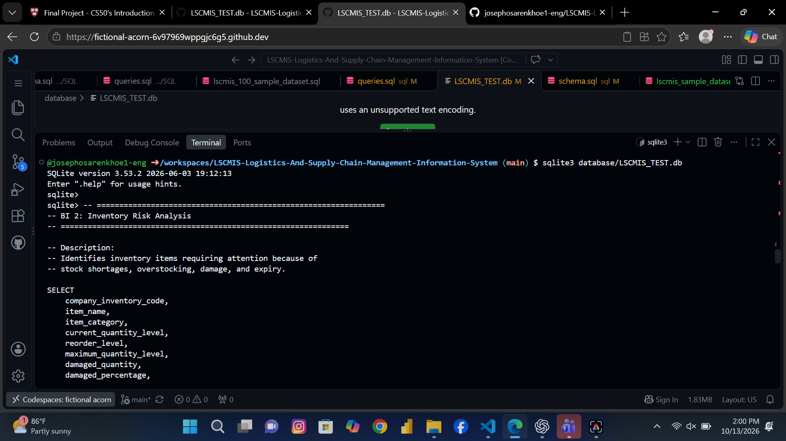
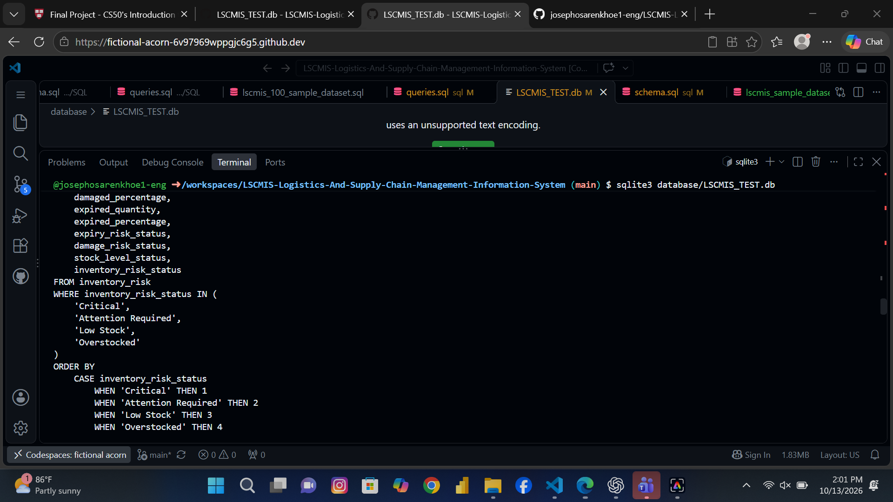
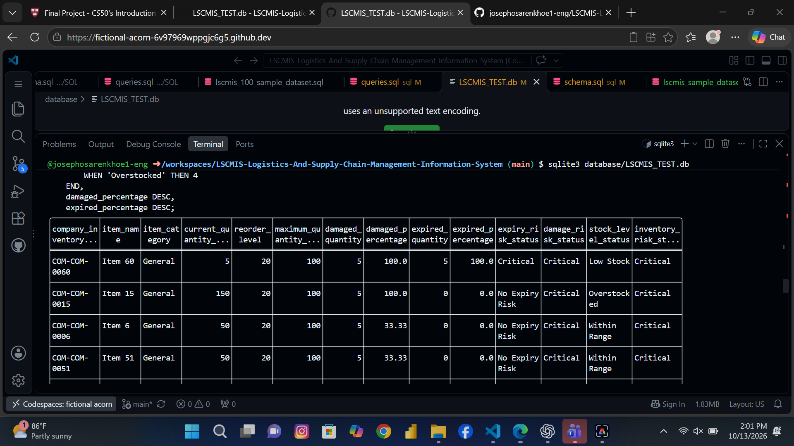
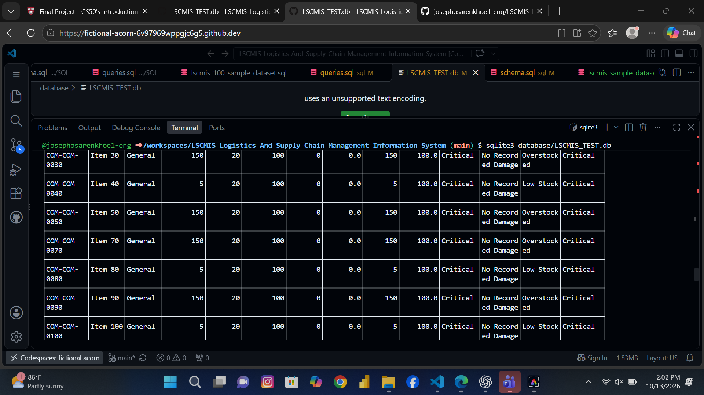
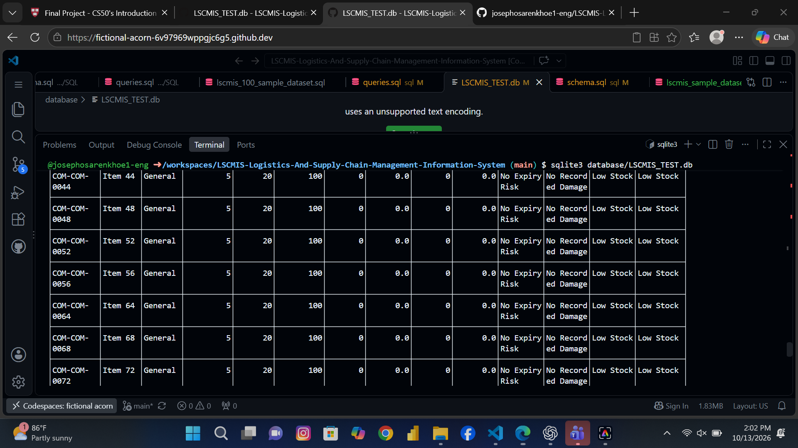
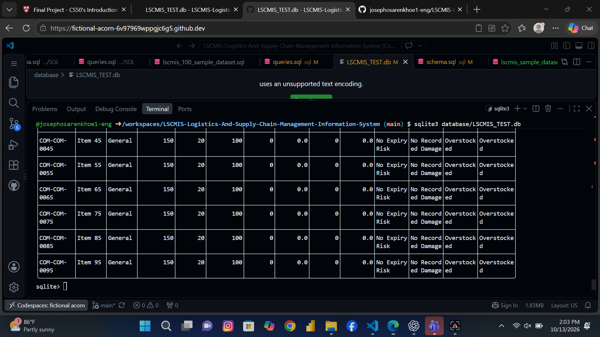

# BI 2: Inventory Risk Analysis

## 1. Business Question

Which inventory items currently represent the greatest operational risk?

## 2. Objective

Identify inventory items requiring management attention by assessing
current stock levels, reorder thresholds, maximum quantity levels,
damaged quantities, and expired quantities.

The analysis classifies inventory risks to help management identify
potential stock shortages, overstocking, damage, and expiry issues.

## 3. Data Source

The analysis uses the `inventory_risk` SQL view, which combines
inventory records, current stock quantities, inventory transactions,
damage metrics, expiry metrics, and risk classifications.

## 4. SQL Techniques Used

- Common Table Expressions (CTEs)
- Aggregate functions
- Conditional logic using CASE
- COALESCE for handling NULL values
- LEFT JOIN
- Calculated columns and percentages
- Filtering using WHERE
- Sorting using ORDER BY

## 5. Key Findings

### Critical Inventory Risks

Some inventory items are classified as Critical because of recorded
damage or expiry risks.

### Overstocked Inventory

Item 15 has a current quantity of 150 units against a maximum
quantity level of 100 units.

The view classifies the item as Overstocked and identifies a
Critical overall inventory risk.

### Expired Inventory

Some inventory items have expired quantities equal to their current
stock quantities. These items are classified as having Critical
expiry risk.

### Low Stock

Items with current quantities at or below their reorder levels
are classified as Low Stock.

### Independent Risk Classification

The analysis displays separate expiry, damage, stock-level, and
overall risk classifications. This helps management understand
the factors contributing to each item's overall risk.

## 6. Business Value

The analysis can help inventory managers:

- Identify potential stock shortages.
- Investigate excessive inventory levels.
- Prioritise damaged inventory for review.
- Identify expired stock requiring attention.
- Support inventory replenishment and stock-control decisions.

## 7. Query Output

The query returns inventory items classified as Critical,
Attention Required, Low Stock, or Overstocked.

Results are prioritised by overall risk status, followed by
damaged and expired percentages.

## 8. Query Output Screenshots

The following screenshots show the results of the inventory risk analysis query.

### Screenshot 1: Inventory Risk Analysis Results — Part 1

### Screenshot 2: Inventory Risk Analysis Results — Part 2

### Screenshot 3: Inventory Risk Analysis Results — Part 3

### Screenshot 4: Inventory Risk Analysis Results — Part 4

### Screenshot 5: Inventory Risk Analysis Results — Part 5

### Screenshot 6: Inventory Risk Analysis Results — Part 6

### Screenshot 7: Inventory Risk Analysis Results — Part 7

### Screenshot 8: Inventory Risk Analysis Results — Part 8

### Screenshot 9: Inventory Risk Analysis Results — Part 9

### Screenshot 10: Inventory Risk Analysis Results — Part 10

### Screenshot 11: Inventory Risk Analysis Results — Part 11

