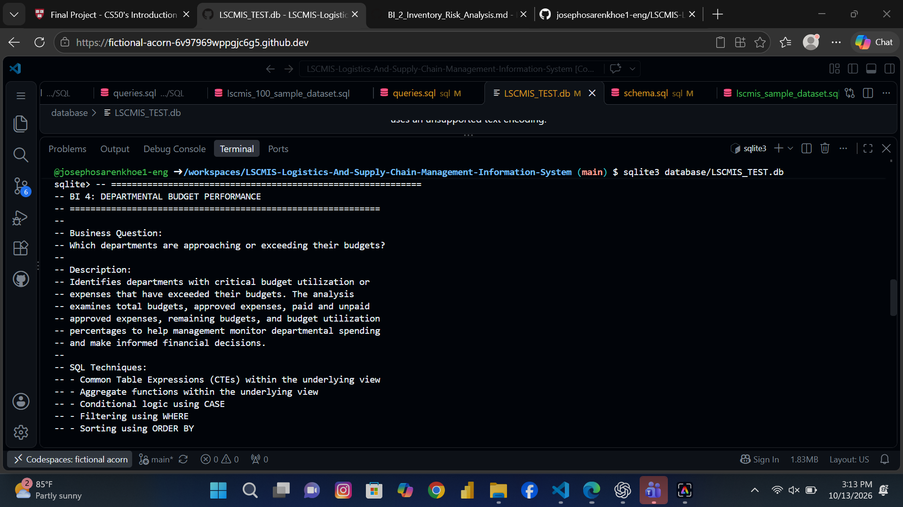
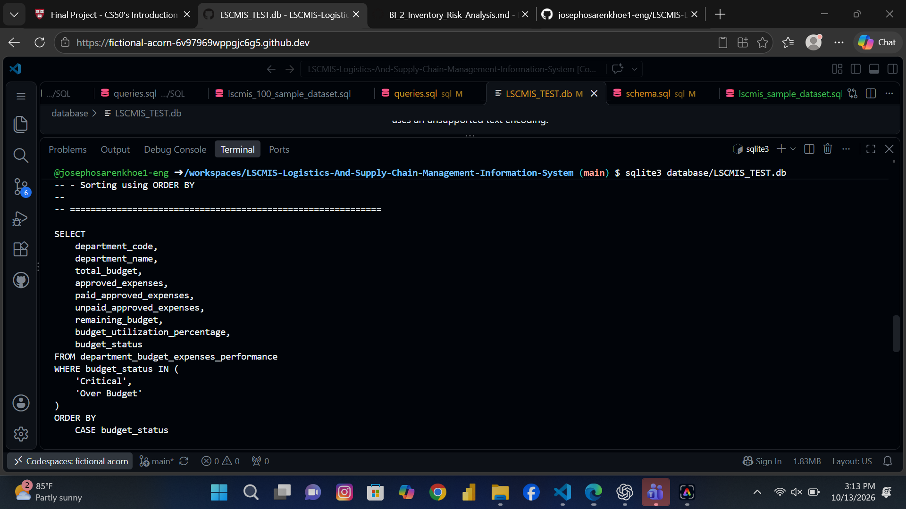
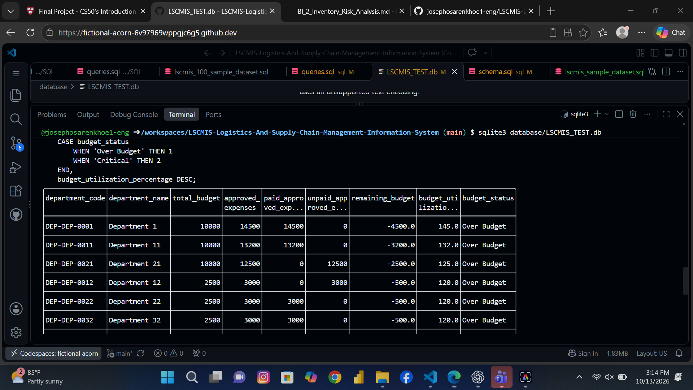
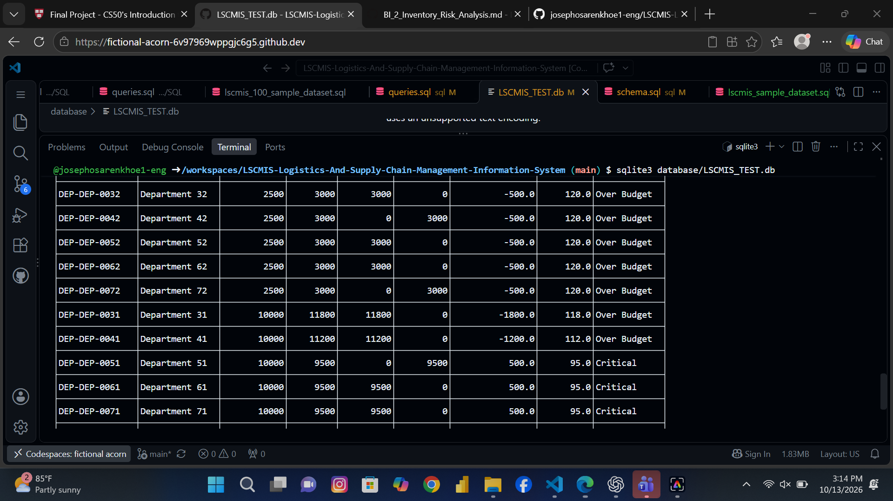
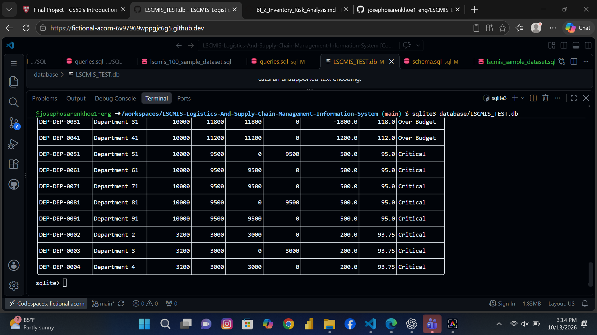

# BI 4: Departmental Budget Performance

## 1. Business Question

Which departments are approaching or exceeding their budgets?

## 2. Objective

Identify departments with critical budget utilization or expenses that have exceeded their budgets.

The analysis examines departmental budgets, approved expenses, paid and unpaid approved expenses, remaining budgets, and budget utilization percentages. It classifies departments according to their budget performance to help management identify potential overspending and departments approaching their budget limits.

## 3. Data Source

The analysis uses the `department_budget_expenses_performance` SQL view, which combines departmental budget allocations, approved expenses, payment information, remaining budgets, budget utilization percentages, and budget status classifications.

## 4. SQL Techniques Used

- Common Table Expressions (CTEs) within the underlying view
- Aggregate functions within the underlying view
- Conditional logic using CASE
- Filtering using WHERE
- Sorting using ORDER BY
- Querying a SQL view
- Financial calculations and percentage analysis

## 5. Key Findings

### Departments Exceeding Their Budgets

Several departments have approved expenses that exceed their allocated budgets. These departments are classified as `Over Budget` and have negative remaining budget balances.

**Department 1**
- Total budget: 10,000
- Approved expenses: 14,500
- Budget utilization: 145%
- Remaining budget: -4,500
- Budget status: Over Budget

Department 1 has spent 4,500 more than its allocated budget. Its approved expenses represent 145% of the budget, indicating that spending has exceeded the allocation by 45%.

**Department 11**
- Total budget: 10,000
- Approved expenses: 13,200
- Budget utilization: 132%
- Remaining budget: -3,200
- Budget status: Over Budget

Department 11 has exceeded its budget by 3,200. Its approved expenses are 32% above the allocated budget.

**Department 21**
- Total budget: 10,000
- Approved expenses: 12,500
- Budget utilization: 125%
- Remaining budget: -2,500
- Budget status: Over Budget

Department 21 has exceeded its budget by 2,500, with expenses reaching 125% of the allocation.

**Other Departments Exceeding Their Budgets**

The results also identify departments with smaller budget allocations that have exceeded their limits.

For example, Department 12 has a budget of 2,500 and approved expenses of 3,000. Its budget utilization is 120%, and its remaining budget is -500.

Departments 22, 32, 42, 52, 62, and 72 also appear in the results with budgets of 2,500, approved expenses of 3,000, and budget utilization of 120%.

Department 31 has a budget of 10,000 and approved expenses of 11,800, representing 118% utilization and a negative remaining budget of 1,800.

Department 41 has a budget of 10,000 and approved expenses of 11,200, representing 112% utilization and a negative remaining budget of 1,200.

These results show that overspending affects departments with both larger and smaller budget allocations.

### Departments Approaching Their Budget Limits

The report also identifies departments classified as `Critical`, indicating that their budget utilization has reached a critical level.

The screenshots show several departments with the following figures:

- Total budget: 10,000
- Approved expenses: 9,500
- Budget utilization: 95%
- Remaining budget: 500
- Budget status: Critical

These results are visible for Departments 51, 61, 71, 81, and 91.

Each of these departments has used 95% of its allocated budget, leaving only 5% available.

For departments with a budget of 3,200, the results also show approved expenses of 3,000, budget utilization of 93.75%, and a remaining budget of 200.

Examples include Departments 2, 3, and 4.

These departments have not exceeded their budgets, but their remaining funds are relatively limited compared with their allocations.

### Departments with the Highest Budget Utilization

The query sorts departments by budget status and then by budget utilization percentage in descending order.

Departments classified as `Over Budget` appear before those classified as `Critical`.

Within each status, departments with higher budget utilization percentages appear first.

This ordering makes it easier for management to identify departments with the greatest immediate budget concerns.

Department 1 appears among the highest-priority cases, with budget utilization of 145%, followed by Department 11 at 132% and Department 21 at 125%.

### Paid and Unpaid Approved Expenses

The report separates approved expenses into paid and unpaid amounts.

For example, Department 1 has approved expenses of 14,500, all of which are recorded as paid approved expenses. Its unpaid approved expenses are zero.

Department 21 has approved expenses of 12,500, all of which are recorded as unpaid approved expenses. Its paid approved expenses are zero.

This distinction helps management understand the payment position of approved expenses.

However, paid and unpaid status does not change the fact that approved expenses can exceed the allocated budget. Management should therefore monitor both the amount approved and the amount already paid.

## 6. Business Value

This analysis can help management:

- Identify departments that have exceeded their budget allocations.
- Prioritize departments with the highest budget utilization.
- Monitor departments approaching their budget limits.
- Identify negative remaining budget balances requiring investigation.
- Distinguish between paid and unpaid approved expenses.
- Improve departmental spending controls.
- Support budget reviews and future financial planning.
- Make more informed decisions about expenditure approvals and resource allocation.

## 7. Query Output

The query returns departments whose budget status is either `Critical` or `Over Budget`.

The results include department codes, department names, total budgets, approved expenses, paid and unpaid approved expenses, remaining budgets, budget utilization percentages, and budget status.

Departments classified as `Over Budget` are displayed first, followed by departments classified as `Critical`.

Within each category, results are ordered by budget utilization percentage in descending order.

The output demonstrates how SQL can be used to identify budget overruns, monitor remaining funds, and highlight departments requiring financial attention.

## 8. Query Output Screenshots

The following screenshots show the results of the departmental budget performance query.

### Screenshot 1: Departmental Budget Performance Results — Part 1

### Screenshot 2: Departmental Budget Performance Results — Part 2

### Screenshot 3: Departmental Budget Performance Results — Part 3

### Screenshot 4: Departmental Budget Performance Results — Part 4

### Screenshot 5: Departmental Budget Performance Results — Part 5

